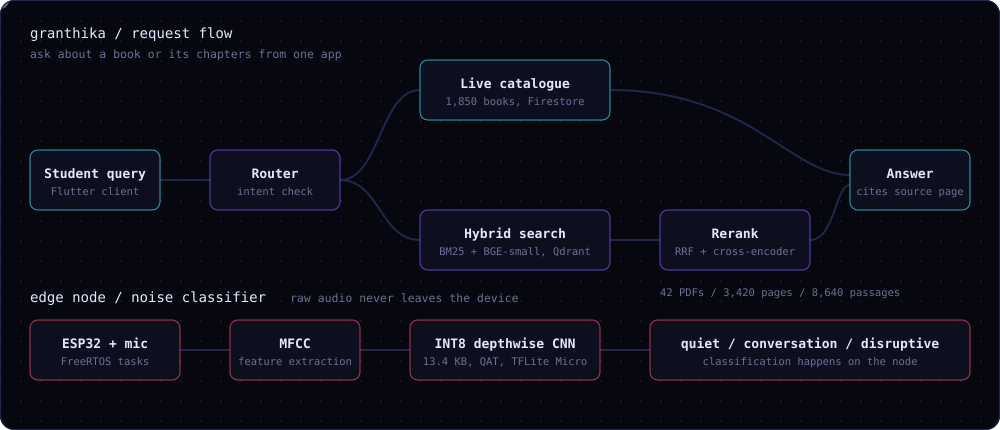

 

**Final-year IT student at APSIT, Mumbai. I build apps that talk to hardware, retrieve the right page, and don't lose money when two requests collide.**

[LinkedIn](https://linkedin.com/in/gourish-pednekar-5a4908382) &nbsp;|&nbsp; [Email](mailto:gourishpednekar221@gmail.com) &nbsp;|&nbsp; [Resume](#)

 

## Shipped

<table>
<tr>
<td width="50%" valign="top">

### [Granthika](https://github.com/Gourish-Pednekar/granthika)
Library platform with ~3,000 registered users. One app finds a book in the live catalogue (1,850 titles) or answers questions from 42 PDFs with hybrid retrieval and page citations. A 13.4 KB INT8 CNN on ESP32 nodes classifies library noise on-device.

`Flutter` `FastAPI` `Qdrant` `Firebase` `TFLite Micro`

</td>
<td width="50%" valign="top">

### [Double-Entry Ledger](https://github.com/Gourish-Pednekar/ledger-service)
Banking backend where PostgreSQL triggers reject unbalanced entries and block edits to history. Ordered row locking fixed a transfer race: 5 runs of 2,000 transfers on 32 threads, zero overdrafts, zero deadlocks. Statement query 141 ms to 42 ms.

`Java 21` `Spring Boot` `PostgreSQL` `Testcontainers`

</td>
</tr>
<tr>
<td width="50%" valign="top">

### [Farmer RAG Chatbot](https://github.com/Gourish-Pednekar/rag-farmer-chatbot)
Built at Rallis (Tata). Answers in English, Hindi and Marathi from a 159-page product catalogue, with source pages and a context-only prompt that declines out-of-scope questions. Compared 4 pipelines; LangChain + Groq won.

`LangChain` `FAISS` `Groq` `Streamlit`

</td>
<td width="50%" valign="top">

### [OleoGuard Nexus](https://github.com/Gourish-Pednekar/oleoguard-nexus)
Multilingual Flutter app that reads price-hedging advice aloud to oilseed farmers. Prophet forecasts 1 to 3 months out at 8% MAPE on test data, with a hedged vs unhedged income simulation.

`Flutter` `FastAPI` `Prophet` `Firestore`

</td>
</tr>
</table>

## Telemetry

